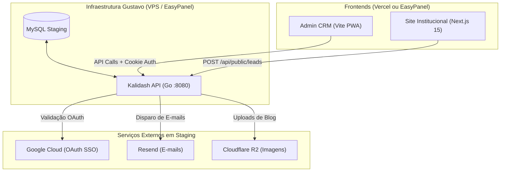

# 🚀 Guia e Runbook de Pré-Produção (Staging)

> **Contexto:** Nesta fase, a **VPS (EasyPanel / Docker)** e o **Banco de Dados (MySQL)** pertencem à infraestrutura do Gustavo.  
> Este documento fornece o roteiro passo a passo para colocar a API Go, o Admin PWA e o Site Next.js no ar em ambiente isolado de pré-produção antes do repasse final para a infraestrutura do cliente.

---

## 1. Topologia de Pré-Produção



### Arquitetura de Domínios Definida

| Serviço | Domínio Oficial Definido | Subdomínio de Homologação (Opcional) |
| :--- | :--- | :--- |
| **Site Institucional (Next.js)** | `https://kalidash.com` | `https://pre.kalidash.com` |
| **Admin CRM (Vite PWA)** | `https://app.kalidash.com` | `https://app-pre.kalidash.com` |
| **API Backend (Go)** | `https://api.kalidash.com` | `https://api-pre.kalidash.com` |

> [!IMPORTANT]
> **Cookies de Sessão e Domínio Unificado:**  
> Ao adotar `kalidash.com` (Site), `app.kalidash.com` (Admin) e `api.kalidash.com` (API), todos os serviços compartilham o mesmo domínio raiz (`.kalidash.com`).  
> Isso garante que o cookie de autenticação `SameSite=Lax; Secure` funcione com 100% de confiabilidade em todos os navegadores (Chrome, Safari, iOS e Firefox) sem risco de bloqueio de cookies de terceiros.

---

## 2. Passo a Passo: Banco de Dados (MySQL do Gustavo)

### 2.1. Criação do Database
No painel do MySQL (EasyPanel, phpMyAdmin ou terminal):
```sql
CREATE DATABASE kalidash_pre CHARACTER SET utf8mb4 COLLATE utf8mb4_unicode_ci;
```

### 2.2. String de Conexão (DSN)
Monte a string de conexão no formato padrão:
```bash
# Se o MySQL estiver na mesma rede interna do EasyPanel:
DSN="root:sua_senha@tcp(easypanel-mysql:3306)/kalidash_pre?parseTime=true"

# Se o MySQL for externo ou exigir SSL:
DSN="usuario:senha@tcp(host-do-banco:3306)/kalidash_pre?parseTime=true&tls=true"
```

### 2.3. Inicialização de Tabelas
Você tem duas opções (ambas funcionam):
* **Opção Automática (Recomendada):** Ao ligar a API Go pela primeira vez com `WORKFLOW_API=1`, `CRM_API=1` e `AUTH_API=1`, ela executa automaticamente `ensureOpportunitySchema()`, `ensureWorkflowSchema()`, `ensureCRMSchema()`, `ensureAuthSchema()`, `ensureBlogSchema()` e cria todas as tabelas.
* **Opção Prisma (Opcional):**
  ```bash
  cd apps/studio
  npx prisma db push
  ```

---

## 3. Passo a Passo: API Go (`apps/api`) no EasyPanel

### 3.1. Criação do Serviço no EasyPanel
1. No projeto do EasyPanel, clique em **+ New App**.
2. **Build Method:** Escolha **Git Repository** (apontando para o repositório da Kalidash, branch `main` ou `staging`) ou **Dockerfile**.
3. **Context / Base Directory:** `apps/api`
4. **Porta do Container:** `8080`
5. **Domínio:** Adicione o domínio da API (ex: `api-pre.kalidash.com.br`) e ative o SSL automático (Let's Encrypt).

### 3.2. Gerar Segredos Criptográficos de Staging
No seu terminal local, execute para gerar segredos de 32 bytes (64 hex):
```bash
node -e "console.log('DATA_KEY=' + require('crypto').randomBytes(32).toString('hex'))"
node -e "console.log('SESSION_SECRET=' + require('crypto').randomBytes(32).toString('hex'))"
node -e "console.log('REVALIDATE_SECRET=' + require('crypto').randomBytes(32).toString('hex'))"
```

### 3.3. Tabela Completa de Variáveis de Ambiente da API (Pré-Produção)

Cole estas variáveis no menu **Environment** do serviço no EasyPanel:

```ini
# Servidor e Banco
PORT=:8080
DSN=usuario:senha@tcp(host-banco:3306)/kalidash_pre?parseTime=true

# Módulos Ativos
WORKFLOW_API=1
CRM_API=1
AUTH_API=1

# Criptografia e Sessão
DATA_KEY=coloque_a_chave_hex_64_gerada_acima
SESSION_SECRET=coloque_o_segredo_hex_64_gerado_acima

# CORS e URLs (sem barra no final)
ALLOWED_ORIGINS=https://app.kalidash.com,https://kalidash.com
SITE_URL=https://kalidash.com
ADMIN_URL=https://app.kalidash.com
REVALIDATE_SECRET=coloque_o_revalidate_secret_gerado_acima

# Google Workspace SSO
GOOGLE_CLIENT_ID=seu_client_id.apps.googleusercontent.com
GOOGLE_CLIENT_SECRET=seu_client_secret
GOOGLE_REDIRECT_URL=https://api.kalidash.com/auth/google/callback
GOOGLE_HD=kalidash.com
AUTH_ROOT_ADMIN=seu_email@kalidash.com

# E-mails (Resend)
RESEND_API_KEY=re_sua_chave_resend
RESEND_FROM_EMAIL=Kalidash CRM <onboarding@resend.dev>

# Armazenamento de Imagens do Blog (R2)
R2_ACCOUNT_ID=sua_conta_cloudflare
R2_ACCESS_KEY_ID=seu_token_r2
R2_SECRET_ACCESS_KEY=seu_secret_r2
R2_BUCKET=kalidash-blog
R2_PUBLIC_URL=https://pub-xxxx.r2.dev

# Taxas do Connect.js
CONNECT_RATE_IP=10
CONNECT_RATE_TOKEN=60
CONNECT_RATE_CONFIG=60
```

---

## 4. Passo a Passo: Admin PWA (`apps/admin`)

### Opção A: Deploy na Vercel (Mais rápido para preview)
1. Conecte o repositório na Vercel.
2. **Root Directory:** `apps/admin`
3. **Framework Preset:** Vite
4. **Environment Variables:**
   ```ini
   VITE_API_URL=https://api.kalidash.com
   ```
5. Cadastre o domínio personalizado `app.kalidash.com` (ou subdomínio de preview).

### Opção B: Deploy no EasyPanel (Static Nginx)
1. No EasyPanel, crie um App com método **Static/Nginx**.
2. **Build Command:** `pnpm build`
3. **Publish Directory:** `dist`
4. **Environment Variables:** `VITE_API_URL=https://api.kalidash.com`

---

## 5. Passo a Passo: Site Institucional (`apps/site`)

### Deploy na Vercel (Recomendado para Next.js 15)
1. Conecte o repositório na Vercel.
2. **Root Directory:** `apps/site`
3. **Framework Preset:** Next.js
4. **Environment Variables:**
   ```ini
   API_URL=https://api.kalidash.com
   NEXT_PUBLIC_LEAD_ENDPOINT=https://api.kalidash.com/api/public/leads
   NEXT_PUBLIC_ADMIN_ORIGINS=https://app.kalidash.com
   NEXT_PUBLIC_SITE_URL=https://kalidash.com
   REVALIDATE_SECRET=mesmo_revalidate_secret_definido_na_api
   NEXT_PUBLIC_GTM_ID=GTM-XXXXXXX
   ```
5. Cadastre o domínio principal `kalidash.com`.
5. Cadastre o domínio personalizado `pre.kalidash.com.br`.

---

## 6. Configuração no Google Cloud Console (OAuth 2.0)

Para que o login com a conta Google corporativa funcione em pré-produção sem afetar o localhost:

1. Acesse o [Google Cloud Console](https://console.cloud.google.com).
2. Vá em **APIs e Serviços > Credenciais > IDs do cliente OAuth 2.0** (clique no cliente web existente).
3. Em **Origens JavaScript autorizadas**, adicione:
   * `https://admin-pre.kalidash.com.br`
4. Em **URIs de redirecionamento autorizados**, adicione:
   * `https://api-pre.kalidash.com.br/auth/google/callback`
5. Salve as alterações. (O Google pode levar de 2 a 5 minutos para propagar).

---

## 7. Roteiro de Testes e Homologação (Smoke Test Pré-Produção)

Após subir os 3 serviços:

1. **Healthcheck da API:**
   * Abra no navegador: `https://api-pre.kalidash.com.br/api/blog/settings`
   * Deve retornar status `200` com JSON.
2. **Login no Admin com Google Workspace:**
   * Acesse `https://admin-pre.kalidash.com.br/login`.
   * Clique em "Entrar com Google" usando a conta cadastrada em `AUTH_ROOT_ADMIN`.
   * O fluxo deve redirecionar para a API, autenticar e retornar ao Admin logado como Administrador.
3. **Captura de Lead pelo Site de Staging:**
   * Acesse `https://pre.kalidash.com.br/diagnostico?utm_source=teste_pre&utm_campaign=staging`.
   * Preencha o diagnóstico e conclua o envio.
   * Abra o Admin em `https://admin-pre.kalidash.com.br/leads` e confirme que o lead entrou na coluna inicial com os parâmetros de atribuição (`utm_source: teste_pre`).
4. **Disparo de E-mail de Teste:**
   * No Admin, acesse **E-mails > Modelos Visuais**.
   * Clique em "Enviar Teste". A mensagem deve chegar na caixa do usuário logado via Resend.
5. **Revalidação de Conteúdo (ISR):**
   * Edite um artigo de blog no Admin e salve. Verifique se o site atualiza a página pública imediatamente sem rebuild.
